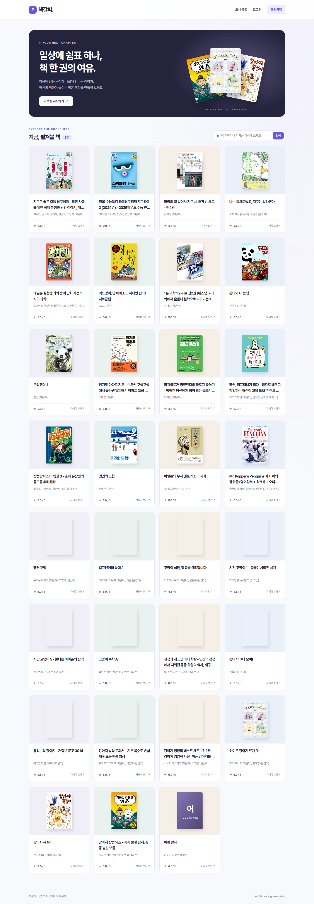

# 책갈피 · Django 도서 기록 서비스

> SSAFY PJT 04 · 2026-10-29 작업 기록 · Python 3.11.9 / Django 5.2.6 / SQLite / Bootstrap 5.3.3

## 프로젝트 소개

회원 인증과 도서 CRUD를 갖춘 로컬 웹 애플리케이션이다. 제목·저자 검색, 독서 프로필, 책 표지 카드와 모바일 화면을 함께 구성했다. 기존 PJT 03 정적 화면과 별도로 실행하는 Django 프로젝트이며, 기존 화면에 인증 서버를 통합 배포한 결과물은 아니다.

- [실행 소스와 README](../../pjt04-bookmark/README.md)
- [요구사항별 구현 근거](../../pjt04-bookmark/docs/requirements.md)
- [실행 화면 21장](../../pjt04-bookmark/screenshots/README.md)
- [테스트 코드](../../pjt04-bookmark/books/tests.py), [인증 테스트](../../pjt04-bookmark/accounts/tests.py)

## 문제와 구현 결과

| 과제 | 적용한 방식 | 검증 범위 |
|---|---|---|
| 회원 정보·세션 관리 | AbstractUser, 회원가입·수정 폼, 로그인·로그아웃·탈퇴, 비밀번호 변경 후 세션 갱신 | 잘못된 인증, 중복 아이디, 변경 후 세션 유지 |
| 도서 데이터 관리 | Book ModelForm, ORM CRUD, 제목·저자 검색, 평점 0~5 검증 | 입력 경계값, 빈 입력, 검색 결과 없음, 존재하지 않는 도서 |
| 변경 요청의 접근 제한 | login_required, POST 전용 변경 엔드포인트, CSRF | 비로그인 변경 차단, 지원하지 않는 메서드, 권한 필드 조작 |
| 시연 환경 재현 | 마이그레이션, 제공 자료 30권의 seed_books 명령, 정적 글꼴·표지·Bootstrap | 빈 DB 설치, 반복 로드 시 중복 방지 및 기존 소개 보존 |
| 가독성 | 20~30대 대상 화면 피드백을 반영한 Pretendard, 라벤더·남색·보라색 UI, 반응형 카드와 폼 | Chrome 1440px·390px 확인, 가로 넘침 없음 |

필수 기능·비기능 요구사항 18개와 선택 심화 중 사용자 확장·프로필 2개를 구현했다. AI 작가 정보 생성은 선택 범위로 구현하지 않았다.

## 확인 가능한 결과

- Python 3.11.9의 새 환경과 빈 DB에서 자동 테스트 20개 통과. 시스템 검사 오류 및 추가 마이그레이션 없음.
- 브라우저에서 회원가입 → 도서 생성·수정·삭제 → 회원정보 수정 → 비밀번호 변경 → 로그아웃 → 새 비밀번호 로그인 → 탈퇴 흐름 확인.
- 오류·처리 결과 및 모바일 화면을 포함한 실행 캡처 21장.
- 제공 자료 30권을 반복 실행 가능한 관리 명령으로 로드. 기존 시연 DB에는 앞서 등록한 1권을 포함해 31권이 있었지만 신규 설치 기준 데이터는 30권이다.
- 과제용 GitLab master에 최종 커밋 d7a7021db0b6dea4fa2cdc4482723740ae9c8027을 push하고 원격 SHA 일치를 확인했다. 이후 GitLab 서버 접근 지연은 재확인 과정에서 발생했다.

위 테스트는 AI 에이전트가 실행한 로컬 검증 결과다. 실제 사용자 수·운영 성과·성능 개선율을 측정한 결과는 아니다. GitHub Pages는 이 Django 서버를 실행하지 않으며, 오늘 작업의 공개 서버 배포는 수행하지 않았다.

## 역할과 AI 활용

본인은 명세 기반 제작과 제출을 요청하고, 화면을 확인한 뒤 도서가 한 권뿐인 점과 가독성 문제를 지적했다. 이후 20~30대를 대상으로 배경과 UI를 수정하도록 방향을 정하고 GitLab 및 취업용 GitHub 정리를 요청했다.

명세 분석, 코드 작성·수정, 자료 로드, 브라우저 확인, 테스트 실행, 캡처와 문서 작성 및 Git 업로드는 Codex의 지원으로 수행했다. 결과물의 기술 구조와 검증 사실을 본인의 단독 코딩·디버깅 성과로 확대하지 않는다. 이번 PJT 04의 개인별 기여율과 동료의 세부 구현 내역은 별도로 확인하지 않았다. 이전 PJT 03의 기여율을 이번 작업에 적용하지 않는다.

## 이력서용 요약 초안

**책갈피 | Django 기반 도서 기록 서비스 | 2026.10.29 작업**

- 명세 기반 인증·도서 CRUD 프로젝트의 제작과 제출을 추진하고, 사용 화면 확인을 통해 데이터 구성 및 20~30대 대상 UI 개선 방향을 구체화.
- Codex를 활용해 회원 인증·독서 프로필·도서 검색을 갖춘 Django 결과물을 구성하고, 자동 테스트 20개와 실행 화면 21장으로 기능 및 오류 처리의 검증 근거를 정리.
- 빈 DB 마이그레이션과 중복 방지 데이터 로드 절차를 포함한 실행 안내를 정리하고 GitLab 제출 및 GitHub 포트폴리오 기록으로 연결.

기술 구현을 직접 설명하는 면접에 대비해 인증 폼과 ModelForm의 차이, CSRF와 로그인 제한, 비밀번호 변경 후 세션 갱신, seed 명령의 중복 방지 원리를 코드와 함께 복습할 수 있다.

## 공개 자료 범위

과제 PDF·원본 교육 자료 묶음·개인 취업 서류·연락처·실행 DB·계정 비밀번호·가상환경은 포함하지 않는다. 표지와 도서 설명은 제공 자료를 기반으로 한 교육 시연용이며 원 권리자의 권리를 유지한다. 출처와 라이선스는 프로젝트 데이터·정적 파일 폴더에 기록했다.

